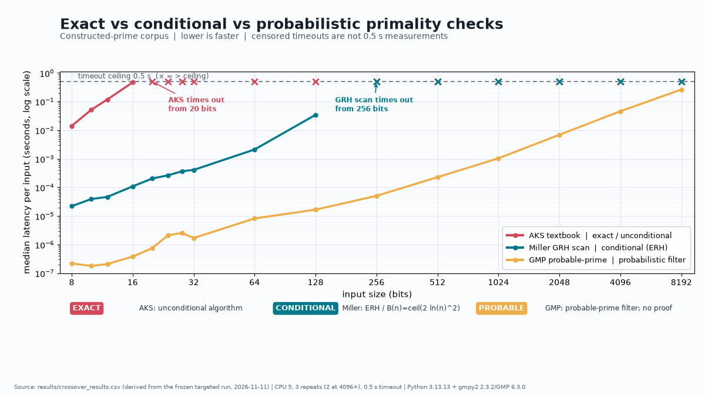

# GRH Miller vs. textbook AKS

This repository contains a transparent Miller witness scan and a reference implementation of textbook AKS, with measured comparisons against practical probable-prime filters.



The graph uses the constructed-prime timing subset (three repeats, two at the largest sizes, 0.5 s per-input timeout). The lower panel summarizes the complete bucket-level crossover table.

## Results

The benchmark ran on Python 3.13 + GMP with one pinned CPU core.

| Result | Measurement |
|---|---:|
| Miller faster | 107 of 178 buckets |
| AKS faster | 5 buckets, all perfect-power early exits |
| Mixed | 1 bucket |
| Miller completed while AKS timed out | 65 buckets; lower bounds only |
| 64-bit balanced semiprime: Miller / AKS | 9.294 µs / 351.791 ms |
| Same case: AKS-to-Miller median ratio | **37,851×** |

The bucket counts describe distribution/bit-length groups, not individual inputs. Timeout rows are censored and are never treated as finite speedups. These measurements compare these Python+GMP implementations and input constructions; they are not asymptotic claims.

The practical filters are faster than both exact comparison targets, but they have different correctness status:

- **Textbook AKS** is deterministic and exact, unconditionally, for the implemented algorithm. This is a clear reference implementation, not an optimized Lenstra–Pomerance prover.
- **Miller GRH reference** scans bases `2..min(ceil(2 ln(n)^2), n-2)`. The bound is conditional on ERH and must not be called unconditional.
- **Fixed-base Miller–Rabin, GMP probable-prime, and Baillie–PSW** are practical probable-prime filters. They are not arbitrary-input proof procedures.

The official QRH-derived mode is intentionally unavailable as a theorem-backed scan. The reviewed September material gives an unspecified constant `C` for a bound on prime quadratic nonresidues, and the October material gives no numeric uniform strong-witness cutoff for arbitrary composites. Parameterized `C,k` experiments are exploratory only. The companion [`src/qrh_miller.py`](src/qrh_miller.py) makes this distinction explicit: `assumed_qrh_bound` requires a caller-supplied constant and reports its conditional status; `qrh_exact_with_aks_fallback` scans such a prefix and then delegates to exact AKS; and `exhaustive_miller` is an exact diagnostic scan with no polynomial-time claim. Supplying `C=1` (or any other guessed constant) does not turn the first mode into an unconditional implementation.

## Algorithms

For an odd `n > 2`, write `n - 1 = 2^s d` with `d` odd. A base `a` passes the strong Miller test when `a^d = 1 (mod n)` or one of the successive squares equals `-1 (mod n)`. The scan exits at the first witness. Boundary values, even inputs, perfect powers, the base cap, optional gcd shortcuts, modular-exponentiation counts, and phase timings are handled in [`src/miller.py`](src/miller.py).

The AKS implementation follows the Agrawal–Kayal–Saxena specification: perfect-power rejection, the smallest `r` with `ord_r(n) > log2(n)^2`, gcd checks, the `n <= r` early result, and polynomial congruences in `(Z/nZ)[X]/(X^r - 1)`. Polynomial products use GMP-backed packed integer multiplication and are cross-checked against an independent schoolbook implementation in the original experiment.

## What the QRH result does and does not establish

The OpenAI September and October preprints claim a zero-free region for certain Hecke/Dirichlet `L`-functions and derive a polylogarithmic bound on a least quadratic nonresidue. The papers explicitly say that this is not a proof of RH or generalized RH. The stated corollary leaves its multiplicative constant unspecified, and the quadratic-nonresidue statement is not itself an explicit, uniform strong-Miller witness theorem for every composite input. The October text describes a deterministic polynomial-time Miller application at the existence level, but does not provide the numerical cutoff needed to run that claim as a self-contained exact algorithm.

Accordingly, this repository uses four separate labels:

* **Conditional reference:** the classical `ceil(2 ln(n)^2)` scan, conditional on ERH/GRH as documented by Bach.
* **QRH assumption model:** `ceil(C log(n)^k)` with `C` and `k` supplied by the user. This is useful for sensitivity plots, but its proof status is conditional/exploratory unless an explicit source supplies that exact pair and its reduction to strong witnesses.
* **Exact QRH-prefix wrapper:** scan the supplied prefix and fall back to textbook AKS. The complete decision is unconditional because AKS decides the remaining cases; QRH affects only an optional early exit and supplies no unconditional speed guarantee.
* **Exhaustive diagnostic:** scan every base through `n-2`. This is exact for the tested input but is not a scalable polynomial-time method.

The phrase “unconditional QRH Miller” is therefore avoided. Accepting the OpenAI theorem may support an existence-level polynomial-time conclusion, but a reproducible implementation still needs an explicit constant, a precise logarithm convention, and a proved reduction from the theorem's number-theoretic statement to the strong-witness range.

## Run it

Install the small dependency set, run the quick comparison, and regenerate the figure:

```bash
python3 -m venv .venv
.venv/bin/pip install -r requirements.txt
.venv/bin/python scripts/benchmark.py --cpu 0
.venv/bin/python plots/plot_crossover.py
.venv/bin/python -m unittest discover -s tests -v
```

The quick benchmark writes `results/quick_benchmark.csv`. The committed result tables are [`results/benchmark.csv`](results/benchmark.csv) and [`results/crossover.csv`](results/crossover.csv). The plotting input is [`plots/crossover_results.csv`](plots/crossover_results.csv).

The larger corpus and exhaustive validation are summarized in the source experiment report. The retained corpus has 240 records / 229 unique integers, and independent validation covered every odd input through `2^24 - 1`; no GRH-reference false prime was found in that range.

For a direct call, use `assumed_qrh_bound(n, C, exponent=32)` only when you
want to model an explicitly chosen assumption. For an exact decision with a
possible early exit, use `qrh_exact_with_aks_fallback(n, C=...)`; omit `C` to
run AKS directly. The result records whether the answer came from a witness,
a deterministic precheck, or the AKS fallback.

## Tweet draft

> Python+GMP: conditional-ERH Miller beat textbook AKS in 107 buckets; AKS won 5 (perfect powers). 65 were AKS-timeout lower bounds. A 64-bit balanced semiprime showed a 37,851x median ratio. QRH cutoff unavailable (C unspecified). https://github.com/catid/grh_miller

Suggested alt text: “A log-scale graph compares textbook AKS, conditional-ERH Miller, and a GMP probable-prime filter on constructed primes. Miller is faster over completed points; AKS timeout points are marked above the ceiling. A bar chart summarizes 107 Miller wins, 5 AKS wins, 1 mixed bucket, and 65 timeout lower bounds.”

## Sources

The mathematical source notes and proof-status distinctions are in [`sources.md`](sources.md). Primary references include Miller (1975), Bach (1990), Agrawal–Kayal–Saxena (2004), Lenstra–Pomerance, and the September/October 2026 OpenAI QRH preprints. The QRH preprints are treated as claimed research material; no QRH cutoff is presented as theorem-backed code.
